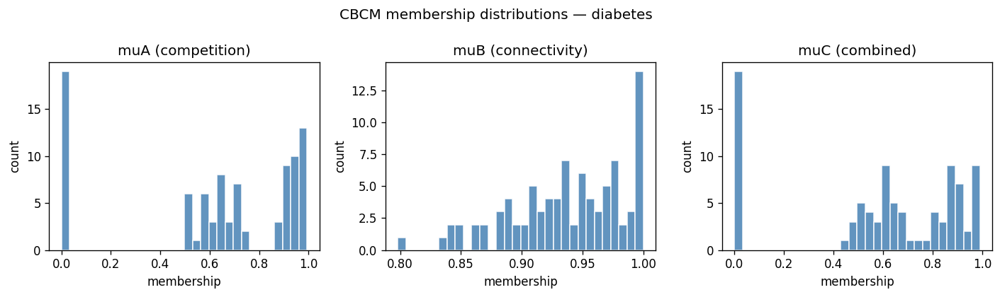
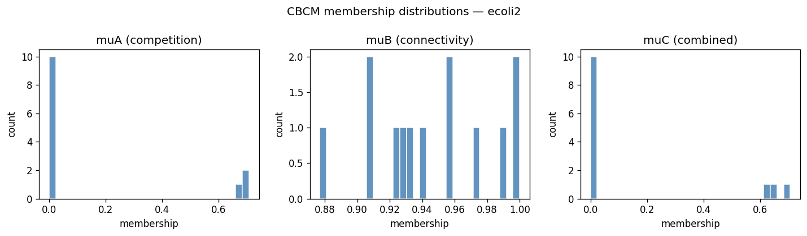
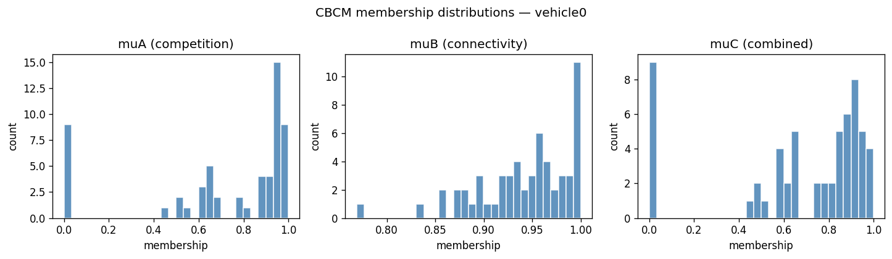

# CBCM Diagnostic Gate Report

**Global gate:** FAIL — do not proceed to training without review

## Configuration
- k formula: max(5, ceil(0.05 * N))
- Permutation null reps: 200
- Bonferroni alpha: 0.05
- Granulation: purity=0.95, min_ball_count=2, seed=42

## diabetes

**Gate:** PASS
- N balls: 90, k=5

### Membership summaries
- **compA**: mean=0.3685, median=0.3487, std=0.2788
- **muA**: mean=0.6199, median=0.6921, std=0.3530
- **muB**: mean=0.9381, median=0.9432, std=0.0475
- **muC**: mean=0.5855, median=0.6303, std=0.3369

### Null-model check (Component A)
- KS statistic: 0.1911
- p-value (raw): 0.002363
- p-value (Bonferroni): 0.007090325103949913
- Minority class KS p: 0.097720
- Majority class KS p: 0.000000

### Redundancy: muB vs CW
- Pearson r: -0.0647
- Spearman r: -0.0572
- Within-class var (+1): 0.002419
- Within-class var (-1): 0.002163

### Redundancy: muA vs muB
- Pearson r (all): 0.2392
- Pearson r (minority only): 0.1126

### Context: muA vs R / BMRU
- muA vs R Pearson: 0.0771
- muA vs BMRU mu Pearson: -0.1594

### Synthetic noise sanity
- Method: farthest_minority_balls
- Noise ball muC percentile: 17.8
- Noise ball naive-density percentile: 82.2

### Stop conditions
- **compA_indistinguishable_from_null**: ok
- **muB_redundant_with_CW**: ok
- **muA_muB_highly_correlated**: ok
- **synthetic_noise_rewarded**: ok

## ecoli2

**Gate:** FAIL
- N balls: 13, k=5

### Membership summaries
- **compA**: mean=0.4100, median=0.0000, std=0.4493
- **muA**: mean=0.1601, median=0.0000, std=0.2925
- **muB**: mean=0.9457, median=0.9404, std=0.0364
- **muC**: mean=0.1541, median=0.0000, std=0.2817

### Null-model check (Component A)
- KS statistic: 0.5346
- p-value (raw): 0.000560
- p-value (Bonferroni): 0.0016803732877787966
- Minority class KS p: 0.000024
- Majority class KS p: 0.000000

### Redundancy: muB vs CW
- Pearson r: -0.2502
- Spearman r: -0.2684
- Within-class var (+1): 0.001789
- Within-class var (-1): 0.000610

### Redundancy: muA vs muB
- Pearson r (all): 0.2483
- Pearson r (minority only): nan

### Context: muA vs R / BMRU
- muA vs R Pearson: 0.2278
- muA vs BMRU mu Pearson: 0.2288

### Synthetic noise sanity
- Method: farthest_minority_balls
- Noise ball muC percentile: 81.2
- Noise ball naive-density percentile: 81.2

### Stop conditions
- **compA_indistinguishable_from_null**: ok
- **muB_redundant_with_CW**: ok
- **muA_muB_highly_correlated**: ok
- **synthetic_noise_rewarded**: TRIGGERED

## vehicle0

**Gate:** PASS
- N balls: 58, k=5

### Membership summaries
- **compA**: mean=0.3642, median=0.3777, std=0.2317
- **muA**: mean=0.7115, median=0.8922, std=0.3380
- **muB**: mean=0.9426, median=0.9535, std=0.0492
- **muC**: mean=0.6714, median=0.8120, std=0.3213

### Null-model check (Component A)
- KS statistic: 0.2135
- p-value (raw): 0.008443
- p-value (Bonferroni): 0.025330385046637982
- Minority class KS p: 0.311318
- Majority class KS p: 0.000069

### Redundancy: muB vs CW
- Pearson r: -0.1260
- Spearman r: -0.0606
- Within-class var (+1): 0.003465
- Within-class var (-1): 0.001729

### Redundancy: muA vs muB
- Pearson r (all): 0.0460
- Pearson r (minority only): 0.0023

### Context: muA vs R / BMRU
- muA vs R Pearson: -0.0858
- muA vs BMRU mu Pearson: -0.1420

### Synthetic noise sanity
- Method: farthest_minority_balls
- Noise ball muC percentile: 30.6
- Noise ball naive-density percentile: 75.5

### Stop conditions
- **compA_indistinguishable_from_null**: ok
- **muB_redundant_with_CW**: ok
- **muA_muB_highly_correlated**: ok
- **synthetic_noise_rewarded**: ok

